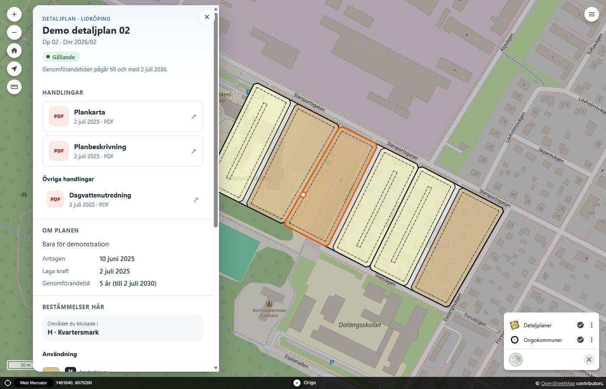
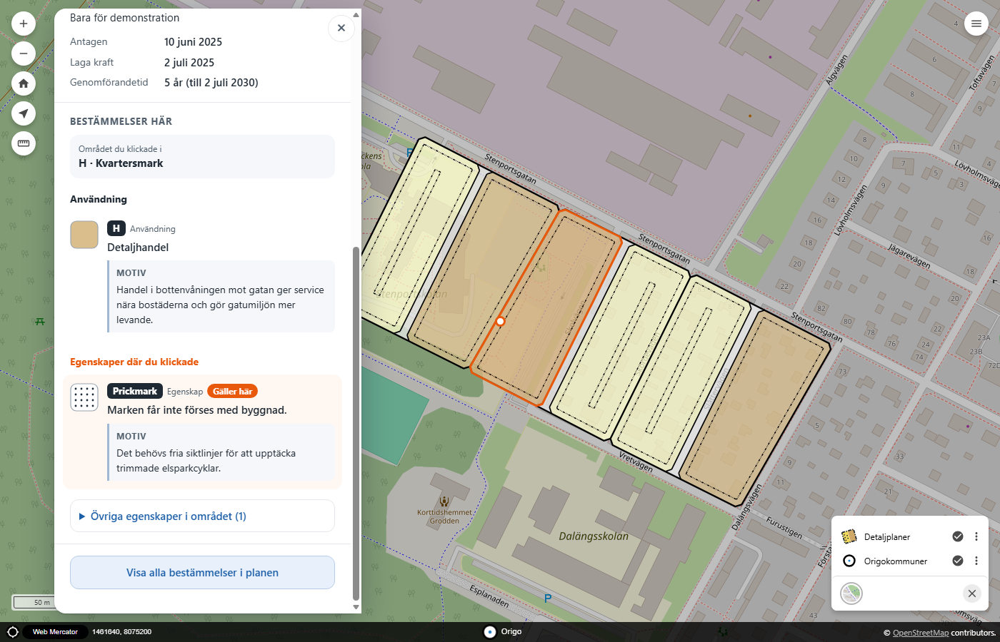

# Rita Detaljplan – integration för Origo

**Visa kommunens detaljplaner i en webbkarta (Origo), direkt ur plandatabasen.** Planerna ritas som plankartor, och ett
klick på en plan öppnar en informationspanel med planens uppgifter, plankartan och planbeskrivningen och alla bestämmelser
i området med motiv. Det här är integrationen för Origo, och vilken kommun som helst kan använda den.

Integrationen kopplar ihop QGIS-pluginet [Rita Detaljplan](https://github.com/ritaplan/rita-detaljplan) med Origo: planerna
som ritas där och checkas in i PostGIS är det som visas i kartan, utan någon export.

<p align="center">
  
</p>

<p align="center">
  
</p>

## Vad du får

| | |
|---|---|
| **Plankarta i webbläsaren** | Användningsytor i Boverkets färger, egenskapsmönster (prickmark, korsmark, ringprickad mark), planområdesgräns, användningsgräns och egenskapsgräns i rätt hierarki. Mått och streckmönster följer kartans skala. |
| **Informationspanel vid klick** | Status i klartext, handlingar (plankarta och planbeskrivning som knappar), syfte, datum och genomförandetid. Bestämmelserna i området med motiv, där de som gäller exakt där man klickade är markerade. Fungerar på dator och telefon. |
| **Två karttjänster att välja mellan** | GeoServer (bilder, vektorrutor och WFS) eller QGIS Server (bilder och WFS). Du behöver bara en. |
| **Bara det som är offentligt** | Karttjänsterna läser en skrivskyddad vy, inte Rita Detaljplans egna tabeller. Du bestämmer vilka planstatusar som visas. |
| **Ingen egen server-kod** | Allt är databasvyer, standardtjänster (WMS, WFS, vektorrutor) och två JavaScript-filer i Origo. |

## Så fungerar det

```
Rita Detaljplan ──checka in──▶ PostGIS: planerna (schemat med plan-tabellerna)
                                        │  vyerna i schemat "publicering": bara offentliga planer
                                        ▼  databasrollen karta_ro: bara läsrätt på vyerna
                          ┌─────────────┴─────────────┐
                      GeoServer                  QGIS Server        (välj en eller båda)
               (bilder + vektorrutor)               (bilder)
                          └─────────────┬─────────────┘
                                        │  WMS / WFS / vektorrutor
                            din Origo-karta  +  planmosaik.js  +  planmosaik-info.js
```

En ny eller ändrad plan syns i kartan så fort den har checkats in i databasen. Vektorrutorna kommer ur en cache och
förnyas inom en minut.

## Det här behöver du

- En PostgreSQL-databas med PostGIS där Rita Detaljplan lägger planerna ("Ny detaljplan", lagring PostGIS).
- En server med **Docker och Docker Compose** och ungefär 1,5 GB ledigt minne för karttjänsterna (GeoServer ~600 MB,
  QGIS Server ~250 MB).
- En webbserver framför (till exempel nginx) som publicerar kartan med HTTPS.
- En Origo-karta (version 2.x). Har du ingen kan du använda exempelkartan i det här repot.

## Snabbstart

```sh
git clone https://github.com/ritaplan/rita-detaljplan-origomap.git
cd rita-detaljplan-origomap
cp .env.exempel .env && nano .env       # databasens adress, planernas schema och koordinatsystem
sh databas/installera.sh                # skapar publiceringsvyerna
sh databas/skapa_roll.sh                # skapar den skrivskyddade databasrollen
sh forbered.sh                          # lösenord och tjänstefil
docker compose up -d                    # startar GeoServer, QGIS Server och exempelkartan
python3 geoserver/konfigurera_geoserver.py
sh qgis/bygg_projekt.sh && docker compose restart qgis-server
sh hamta_origo.sh                       # hämtar Origo till exempelkartan
```

Öppna sedan `http://127.0.0.1:8090/` (eller den port du valt). Steg för steg, med förklaringar och hur du publicerar det
på nätet: **[docs/kom-igang.md](docs/kom-igang.md)**.

## Lägg in det i din egen Origo-karta

Du behöver bara kopiera mappen `origo/` till din webbplats, lägga två rader i `index.html` och ett lager och en källa i
`index.json`. Det tar några minuter: **[docs/origo.md](docs/origo.md)**.

## Dokumentation

| Dokument | Innehåll |
|---|---|
| [docs/kom-igang.md](docs/kom-igang.md) | Installera och publicera, steg för steg. Underhåll och borttagning. |
| [docs/origo.md](docs/origo.md) | Lägg in detaljplanerna i din egen Origo-karta: lager, stil och informationspanel. |
| [docs/data.md](docs/data.md) | Vad ur Rita Detaljplans data som visas, hur planer blir offentliga och hur handlingar och motiv kopplas. |
| [docs/konfiguration.md](docs/konfiguration.md) | Alla inställningar, vyerna och deras kolumner, och hur du ändrar utseendet. |
| [docs/felsokning.md](docs/felsokning.md) | Vanliga problem och hur de rättas. |
| [SECURITY.md](SECURITY.md) | Hur säkerheten är tänkt och hur du rapporterar en säkerhetsbrist. |

## Innehållet i repot

| Mapp eller fil | Vad det är |
|---|---|
| `.env.exempel` | Alla inställningar. Kopieras till `.env`. |
| `databas/` | Publiceringsvyerna (`publicering.sql`) och skripten som skapar dem och den skrivskyddade rollen. |
| `geoserver/` | Inställning av GeoServer (arbetsyta, lager, lagergrupp, vektorrutor) och stilarna (SLD). |
| `qgis/` | Bygger QGIS-projektet som QGIS Server publicerar. |
| `origo/` | **Det som kommer in i din Origo-karta:** stil för vektorrutorna, informationspanelen och lagerexempel. |
| `exempelkarta/` | En färdig Origo-karta att prova med. |
| `nginx/` | Webbservern i exempelmiljön och exempel för din egen webbserver. |
| `stil.py` | Kartans utseende (linjebredder, streckmönster, mönster) på ett ställe, för alla varianter. |
| `testdata/` | Skript som gör demoplaner och testhandlingar, för att prova integrationen utan egna planer. |
| `docker-compose.yml` | GeoServer, QGIS Server och exempelkartans webbserver. |

## Provat med

PostgreSQL 18 med PostGIS 3.6, Rita Detaljplan (schemaversion 11), GeoServer 3.0.2 med tillägget vectortiles, QGIS Server
4.2.3, Origo 2.10.0 och Docker Compose 5. Planernas koordinatsystem kan vara SWEREF 99 TM (EPSG:3006) eller en lokal zon
(EPSG:3007–3018): provat med 3006 och 3008. Origo-kartan kan gå i Web Mercator (EPSG:3857) eller i SWEREF 99 TM (EPSG:3006,
provat med bildlagret): se [docs/origo.md](docs/origo.md#karta-i-sweref-99-tm).

## Begränsningar

- Origo 2.10 kan rita vektorrutor men inte fråga dem. Informationspanelen läser därför alltid uppgifterna ur
  kartservern, oavsett vilket lager som visas (se [docs/origo.md](docs/origo.md)).
- QGIS Servers `FILTER` får aldrig användas mot den publika tjänsten: det blir kvar och tömmer lager för alla besökare
  (se [docs/felsokning.md](docs/felsokning.md)).
- Vyerna räknas om vid varje anrop. Det går bra för några hundra planer: har kommunen många fler, gör om dem till
  materialiserade vyer (se [docs/konfiguration.md](docs/konfiguration.md)).
- Texterna i panelen är på svenska.
- Informationspanelen och stilen för vektorrutorna är gjorda för Origo. Databasvyerna och karttjänsterna (WMS och WFS)
  går att använda i andra kartklienter. Det finns också en integration för Hajk med samma panel:
  [rita-detaljplan-hajk](https://github.com/ritaplan/rita-detaljplan-hajk).

## Bidra och ändringar

- [CONTRIBUTING.md](CONTRIBUTING.md): så rapporterar du fel, provar koden och skickar in en ändring.
- [CHANGELOG.md](CHANGELOG.md): vad som ändrats mellan versionerna.
- [NOTICE.md](NOTICE.md): material från andra och deras villkor.

## Licens

GNU General Public License, version 2 eller senare, som Rita Detaljplan. Se [LICENSE](LICENSE). GeoServer (GPL), QGIS
Server (GPL) och Origo (BSD) har egna licenser. Origo och karttjänsternas avbildningar laddas ner av skripten i repot och
ingår inte här.
